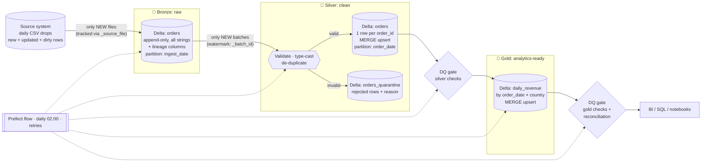

# Mini Lakehouse: Incremental Batch Pipeline (Delta Lake + DuckDB + Prefect)

A small, fully runnable data-engineering project that demonstrates a **medallion architecture**
(raw → clean → analytics-ready) with **incremental loads**, **data-quality gates**,
**orchestration**, and documented **design trade-offs**. It runs on a laptop with no Spark, no JVM, no cloud account.

## Architecture



## Layers

| Layer | Table | Grain | Write pattern | Partition |
|---|---|---|---|---|
| Bronze | `bronze/orders` | one row per source row (as received) | append | `ingest_date` |
| Silver | `silver/orders` | one row per `order_id` (latest version) | MERGE (upsert) | `order_date` |
| Silver | `silver/orders_quarantine` | rejected rows + `_reject_reason` | append | none |
| Gold | `gold/daily_revenue` | `order_date × country` | MERGE (upsert) | none (small table) |

## How the requirements are met

| Requirement | Where |
|---|---|
| Architecture diagram | Mermaid diagram above |
| Raw → clean → analytics-ready | `lakehouse/bronze.py`, `silver.py`, `gold.py` |
| Incremental loads | Bronze skips already-loaded files; Silver reads only `_batch_id > watermark` and **MERGEs** (newer `updated_at` wins); Gold recomputes only affected `order_date`s |
| Data-quality checks & tests | `lakehouse/quality.py` (gates inside the pipeline), `silver.validate` + quarantine, `tests/` (pytest) |
| Scheduling / orchestration | `flows/prefect_flow.py` (retries + cron); CI in `.github/workflows/ci.yml` |
| Trade-offs write-up | [`docs/TRADEOFFS.md`](docs/TRADEOFFS.md) |

## Quick start

In Windows PowerShell, open the project folder and install its dependencies:

```powershell
cd G:\delta-lakehouse-pipelines\01-delta-rs-duckdb-prefect
python -m venv .venv
.\.venv\Scripts\python.exe -m pip install -r requirements.txt
```

Run the pipeline once with Prefect by following the dashboard steps below. To run tests:

```powershell
.\.venv\Scripts\python.exe -m pytest
```

The optional `make demo` command shows the whole story: Delta history on silver/gold goes `WRITE → MERGE`,
the re-run is a no-op, and `silver` + `quarantine` rows always reconcile with `bronze`. It resets the
project's `data` folder first. On Windows, use a shell with GNU Make installed to run the Makefile targets.

### Prefect UI

To keep the dashboard available and retain run history, run a local Prefect server and the flow in
separate PowerShell terminals. First, install dependencies as described above. Use the Python
executable inside `.venv` rather than `prefect.exe`; this avoids launcher path errors if the project
folder was moved.

1. **Terminal 1 — start the Prefect server.** From the project folder, run:
// run them with .venv scripts excluded...since its already activated)
   ```powershell
   .\.venv\Scripts\    python -m prefect server start
   ```

   Leave this terminal open while using Prefect. The local server is normally available at
   <http://127.0.0.1:4200/>.

2. **Terminal 2 — point Prefect at that server and run the pipeline.** Open another PowerShell
   terminal in the same project folder and run:

   ```powershell
   $env:PREFECT_API_URL = "http://127.0.0.1:4200/api"
   .\.venv\Scripts\     python flows\prefect_flow.py
   ```

3. **View the run.** Open <http://127.0.0.1:4200/> in your browser. The flow and its task results
   should appear in the dashboard. Keep Terminal 1 running so the dashboard and run history remain
   available. The `PREFECT_API_URL` setting applies only to Terminal 2; set it again in a new terminal.

To run the flow on its configured daily schedule instead of running it once, use this in Terminal 2
after setting `PREFECT_API_URL`:

```powershell
.\.venv\Scripts\python.exe flows\prefect_flow.py --serve
```

Leave both terminals running for the schedule and dashboard to remain available. The schedule is
daily at 02:00.

## Extract: a real source instead of dropped CSVs (optional)

Bronze reads any new `orders_*.csv` in `data/source/`. That folder is the **contract**, so the
source can change without touching Bronze/Silver/Gold:

| Backend | Select with | What it is |
|---|---|---|
| generator (default) | `make demo` | fake CSV drops, `SOURCE_URL` unset -> extract is skipped |
| hand-written client | `SOURCE_URL=...` | `lakehouse/extract.py`: pagination, `updated_at` watermark, no-op re-runs |
| **dlt** | `SOURCE_URL=... EXTRACT_BACKEND=dlt` | `lakehouse/extract_dlt.py`: same output, incremental state + retries handled by dlt |

```bash
make demo-api        # mock REST API -> extract (requests) -> bronze -> silver -> gold
make demo-api-dlt    # same run, extraction done by dlt
```

`scripts/mock_api.py` is a stdlib mock API (inclusive `updated_since`, pagination). For a real API set
`SOURCE_URL` (and `SOURCE_TOKEN`); the API is assumed to return `{"results": [...], "next": bool}` with the
`RAW_COLS` fields. Verified here against the mock API only, not a third-party API.

## Data quality: three layers of defence

1. **Row-level validation (Silver):** null/unparseable/negative amounts, unknown status, missing keys → **quarantined with a reason**, never silently dropped.
2. **Table-level gates (`quality.py`):** unique keys, non-null keys, value ranges, allowed values. A failure raises `DataQualityError` and **stops the pipeline before bad data reaches Gold**.
3. **Reconciliation:** `bronze rows = valid + duplicates dropped + quarantined` (asserted in code), and `sum(gold.orders) = count(silver)`.

## Testing

* `test_silver_validation.py`: unit tests for every rejection rule.
* `test_extract.py`: runs a real local mock API; checks incremental pulls, the inclusive-boundary no-op, and API -> gold end to end.
* `test_pipeline_e2e.py`: runs the real pipeline in a temp dir and asserts that
  incremental loads only process new files, re-runs are no-ops, updates are applied by MERGE,
  **stale updates do not overwrite newer data**, and the DQ gate fails on corrupted gold.

## Project layout

```
lakehouse/        # paths, generate (fake source), extract (+extract_dlt), bronze, silver, gold, quality, pipeline, show
scripts/          # mock_api.py (fake REST source), demo_api.py
flows/            # Prefect flow
tests/            # pytest
docs/TRADEOFFS.md # design decisions
.github/workflows # CI: tests + demo
```

## Ideas to extend

* Swap local paths for S3/ADLS (`deltalake` supports them), same code.
* Replace the gold SQL with **dbt-duckdb** models + dbt tests.
* Add Great Expectations / Soda for declarative checks.
* Add `OPTIMIZE`/`VACUUM` maintenance task and Z-ordering.
* Stream bronze from Kafka/Kinesis; keep silver/gold as-is.
* Point `extract_dlt.py` at an Airbyte/dlt verified source (Postgres, Stripe, ...) and land to S3 instead of local disk.
