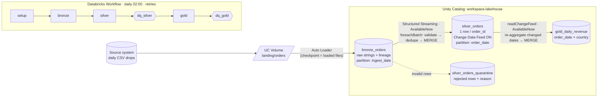

# Lakehouse on Databricks: Auto Loader → Delta → Workflows

The Spark/Databricks version of the incremental medallion pipeline: **raw → clean → analytics-ready**, incremental loads,
data-quality gates, orchestration and a written trade-off analysis. Deployed as a **Databricks Asset Bundle**.

## Architecture



## How the requirements are met

| Requirement | Implementation |
|---|---|
| Architecture diagram | Mermaid above |
| Raw → clean → analytics-ready | `bronze.py` → `silver.py` → `gold.py` (Unity Catalog tables) |
| Incremental loads | **Bronze:** Auto Loader checkpoint. **Silver:** streaming checkpoint + `MERGE` (newer `updated_at` wins). **Gold:** reads silver's **Change Data Feed**, recomputes only changed dates, `MERGE`s |
| Data quality & tests | Row-level quarantine, table-level gates (`quality.py`) as their own Workflow tasks, unit tests + Delta end-to-end tests |
| Scheduling / orchestration | `databricks.yml`: 6-task Workflow, cron schedule, retries, `dev`/`prod` targets |
| Trade-offs write-up | [`docs/TRADEOFFS.md`](docs/TRADEOFFS.md) |

## Project layout

```
databricks.yml            # Asset Bundle: wheel build + Workflow + schedule + dev/prod targets
pyproject.toml            # package + entry points used by python_wheel_task
src/lakehouse_spark/
  transforms.py           # PURE logic: validate, dedupe_latest, gold_aggregate (unit-tested)
  tables.py               # table names, explicit schemas, idempotent DDL (CDF enabled on silver)
  lake.py                 # storage abstraction: Unity Catalog tables  <->  local Delta paths
  bronze.py / silver.py / gold.py / quality.py
  jobs.py                 # Workflow task entry points
  pipeline.py local.py generate.py
scripts/                  # local_demo.py, upload_sample_data.sh
tests/                    # test_transforms.py (plain Spark) · test_pipeline_delta.py (Delta e2e)
```

## Verification status (please read)

| Part | Status |
|---|---|
| `transforms.py` logic (validation rules, dedupe, gold aggregation) | ✅ **Executed** on real PySpark 3.5.3, 5 tests pass |
| Package builds, entry points resolve, `databricks.yml` parses, Delta API calls match `delta-spark` 3.2 signatures | ✅ Checked |
| Delta I/O: MERGE, CDF, streaming checkpoints, quarantine idempotency (`test_pipeline_delta.py`, `local_demo.py`) | ⚠️ **Written but not executed** by the author (no access to Delta JARs where this was built). Run `RUN_DELTA_TESTS=1 pytest` or `python scripts/local_demo.py` first; CI does this automatically |
| Auto Loader (`cloudFiles`), Unity Catalog DDL, Workflow deployment | ⚠️ **Not executed** (requires a Databricks workspace). `ingest_batch` is the local stand-in for Auto Loader |

## Run locally (Java 17/21 + internet once for Delta JARs)

```bash
python -m venv .venv && source .venv/bin/activate
pip install -e ".[dev]"
pytest -v                          # 5 unit tests (+4 Delta tests are skipped)
RUN_DELTA_TESTS=1 pytest -v        # also runs the Delta end-to-end tests
python scripts/local_demo.py       # day 1 → day 2 (incremental) → re-run (no-op) → summary
```

### What the local demo runs and produces

Run `python scripts/local_demo.py` from the `02-spark-databricks` directory. This starts a local
PySpark session with Delta Lake; it does not start a Databricks job or require the Databricks CLI.
The script generates two sample CSV batches and calls `run_all` for each batch, then calls it once
more with no new files to demonstrate an idempotent no-op:

1. **Bronze:** reads new CSV files into the raw Delta table. Locally, this uses batch ingestion
   with source-file tracking as a stand-in for Databricks Auto Loader.
2. **Silver:** validates and types rows, sends invalid rows to quarantine, deduplicates valid rows,
   and merges them into the Silver Delta table.
3. **Silver quality checks:** verifies the Silver table before proceeding.
4. **Gold:** reads Silver's Change Data Feed, aggregates affected dates by country, and merges the
   results into `gold_daily_revenue`.
5. **Gold quality checks:** verifies the Gold result.

The final `gold_daily_revenue` table is the analytics result of those stages: one row per
`order_date` and `country`, with order counts and revenue metrics. The terminal's last `.show(8)`
prints up to eight rows from that table; earlier output shows table row counts, Delta history,
and quarantine reasons. The demo script first removes and recreates its local `data/` directory,
so run it only if that directory does not contain data you need to keep.

## Deploy to Databricks

These commands deploy and run the **Databricks Workflow**, not the local `scripts/local_demo.py`.
The local demo uses local Spark and local Delta paths; the Workflow uses Databricks serverless compute,
Unity Catalog tables, Auto Loader, and UC Volumes.

The following commands are for **one PowerShell window**. Run them from the `02-spark-databricks`
directory and keep that window open so the `$cli` and `$profile` variables remain available. This
works even when the Databricks CLI is installed locally but not added to `PATH`.

1. **Prerequisites:** a Databricks workspace with Unity Catalog, an existing catalog you can use,
   permission to create a schema and volumes in that catalog, Python, and the
   [Databricks CLI](https://docs.databricks.com/dev-tools/cli/).
   Find the locally installed CLI and set the profile name you will use:
   ```powershell
   $cli = Get-ChildItem (Join-Path $env:LOCALAPPDATA 'DatabricksCLI') -Filter databricks.exe -Recurse |
       Select-Object -First 1 -ExpandProperty FullName
   if (-not $cli) { throw 'Databricks CLI not found under %LOCALAPPDATA%\DatabricksCLI' }
   & $cli -v
   $profile = 'delta lakehouse pipeline'
   ```
   Authenticate once using the exact workspace host shown in your browser. When prompted for a
   profile name, enter the same name assigned to `$profile` above:
   ```powershell
   & $cli auth login --host "https://<your-workspace-host>"
   ```
2. **Configure the bundle:** edit `databricks.yml`; set the `dev` workspace host to the same URL
   and set `variables.catalog.default` to an existing catalog in this workspace. To see available
   catalogs, run `SHOW CATALOGS;` in a Databricks SQL editor or notebook. The job creates the
   `lakehouse` schema and its volumes/tables inside that catalog; it does not create the catalog.
   The job is configured for serverless compute and installs the built wheel in its task environment.
3. **Install the wheel build tool, validate, and deploy:**
   ```powershell
   python -m pip install build
   & $cli bundle validate -t dev --profile $profile
   & $cli bundle deploy -t dev --profile $profile
   ```
   Local virtual environments (`.venv*` and `venv*`) are excluded from bundle uploads.
   The deploy builds and uploads the Python wheel and creates the `daily-lakehouse-dev` job. The
   dev schedule is paused, so the job runs only when you trigger it.
4. **Initialize the Unity Catalog resources** by running the job once:
   ```powershell
   & $cli bundle run daily_lakehouse -t dev --profile $profile
   ```
   The `setup` task creates the schema, `landing` and `checkpoints` volumes, and Bronze, Silver,
   quarantine, and Gold Delta tables. The remaining tasks can complete with no landing files.
5. **Upload sample CSV files to the landing volume.** Install the project and generate sample data:
   ```powershell
   python -m pip install -e .
   python -m lakehouse_spark.generate --start 2024-01-01 --days 3 --no-updates --out data/source
   Get-ChildItem data/source/orders_*.csv | ForEach-Object {
       & $cli fs cp $_.FullName "dbfs:/Volumes/workspace/lakehouse/landing/orders/$($_.Name)" --overwrite
   }
   ```
   Change `workspace` and `lakehouse` in the destination if you deployed with different catalog or
   schema values. Alternatively, use `scripts/upload_sample_data.sh workspace lakehouse` from a
   Bash-compatible terminal.
6. **Run the data pipeline** after the files are uploaded:
   ```powershell
   & $cli bundle run daily_lakehouse -t dev --profile $profile
   ```
   The task order is `setup` → `bronze` → `silver` → `dq_silver` → `gold` → `dq_gold`.
   Bronze uses Auto Loader to ingest new files; Silver validates, quarantines rejects, and merges
   orders; the quality tasks gate downstream processing; Gold recomputes affected date/country
   aggregates. The CLI starts the run and reports its status. For task-by-task logs, open the
   Databricks workspace **Workflows / Jobs**, select `daily-lakehouse-dev`, and open the run.
7. **View the final result** in Databricks SQL or a notebook attached to the workspace:
   ```sql
   SELECT * FROM workspace.lakehouse.gold_daily_revenue ORDER BY order_date, country;
   SELECT _reject_reason, COUNT(*)
   FROM workspace.lakehouse.silver_orders_quarantine
   GROUP BY _reject_reason;
   DESCRIBE HISTORY workspace.lakehouse.silver_orders;
   ```
   Replace `workspace.lakehouse` with your catalog and schema. `gold_daily_revenue` is the final
   analytics table: one row per order date and country, with order counts and revenue metrics.
8. **Go live:** deploy the `prod` target with `& $cli bundle deploy -t prod --profile $profile`.
   Its daily 02:00 Africa/Nairobi schedule is unpaused; configure the production host and compute
   first.

## Data quality

1. **Row level (silver):** invalid amount/status/timestamp, missing keys → quarantine table with `_reject_reason`; never silently dropped. Counts reconcile: `in = valid + dupes dropped + quarantined` (asserted per micro-batch).
2. **Table level (`dq_silver`, `dq_gold` tasks):** unique/non-null keys, ranges, allowed values. A failure fails the task, which **blocks every downstream task**.
3. **Cross-layer:** `sum(gold.orders) = count(silver)`.
