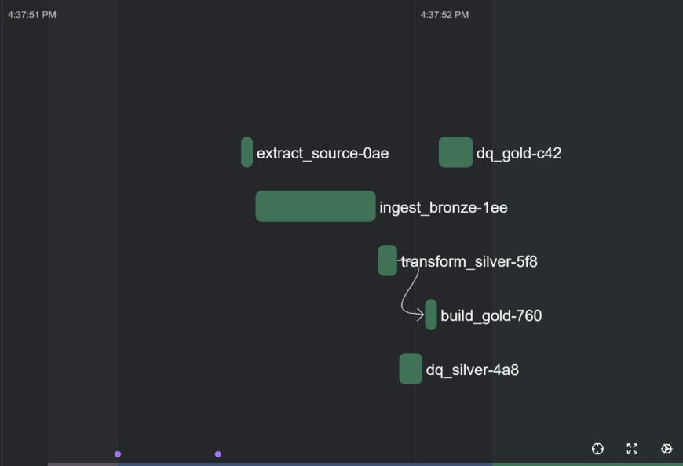
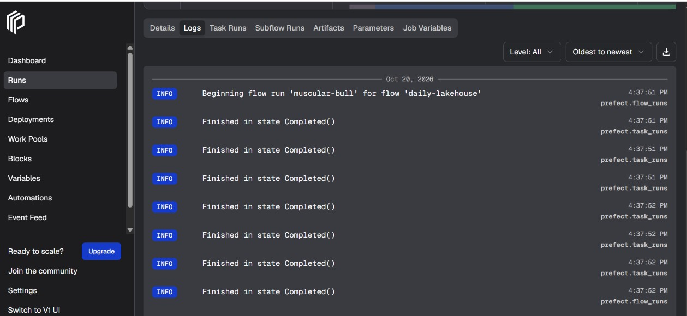
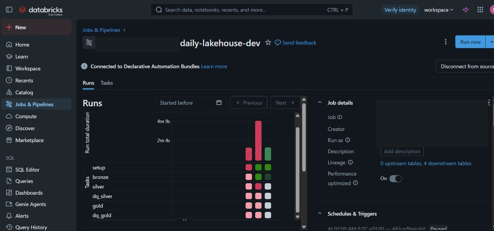
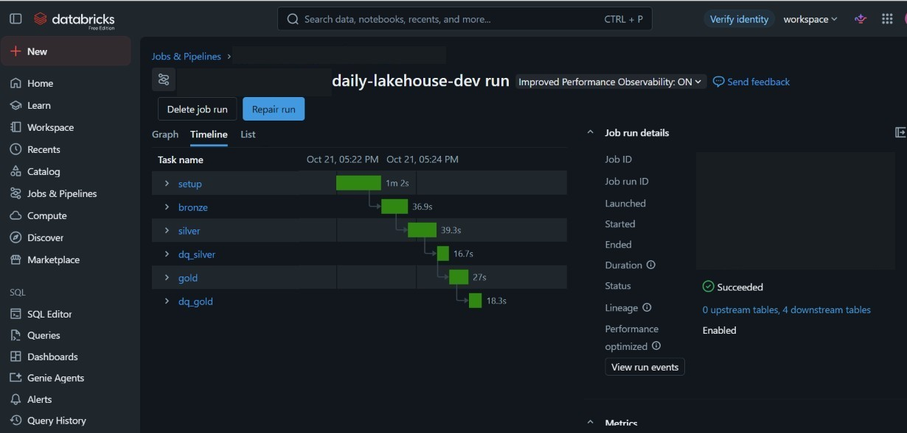
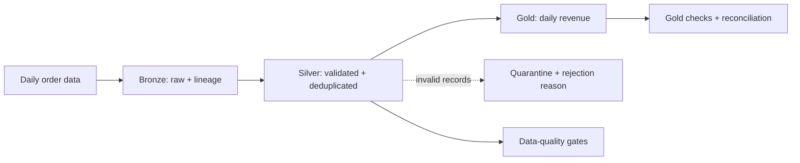

# Incremental Medallion Lakehouse

Two implementations of the same data-engineering pipeline, built to compare a lightweight,
single-machine stack with a Spark and Databricks approach:

1. **Delta Lake + DuckDB + Prefect** — a locally runnable pipeline with no Spark or cloud account.
2. **PySpark + Delta Lake + Databricks** — a scale-out design using Auto Loader, Unity Catalog,
   and Databricks Workflows.

Both projects process daily order data through **Bronze → Silver → Gold**, with incremental
processing, data-quality checks, quarantine for invalid records, and repeatable runs.

## Project screenshots

### Project 01 — Delta Lake, DuckDB & Prefect

| Prefect pipeline run | Completed flow logs |
|---|---|
|  |  |

### Project 02 — Spark & Databricks

| Databricks Workflow runs | Successful end-to-end workflow |
|---|---|
|  |  |

## Projects at a glance

| Project | Stack | Best for | Run location |
|---|---|---|---|
| [01 — Delta-rs, DuckDB & Prefect](./01-delta-rs-duckdb-prefect/README.md) | delta-rs, DuckDB, Prefect | Exploring a complete, lightweight lakehouse pipeline | Local machine; no JVM or cloud account |
| [02 — Spark & Databricks](./02-spark-databricks/README.md) | PySpark, Delta Lake, Auto Loader, Unity Catalog, Workflows | Seeing how the same patterns map to a managed, scalable platform | Locally with Java, or in a Databricks workspace |

Start with **Project 01** for the quickest hands-on run. Continue to **Project 02** to see the
Spark/Databricks design and deployment workflow.

## Shared pipeline



| Layer | Purpose | Typical data |
|---|---|---|
| **Bronze** | Preserve source records and ingestion lineage | Raw order rows |
| **Silver** | Validate, type, deduplicate, and upsert current order records | Clean orders; rejected rows are quarantined |
| **Gold** | Produce analytics-ready aggregates | Daily revenue and order counts by date and country |

Both pipelines are designed to handle repeated runs safely and to prevent invalid data from
silently flowing into analytics. Their implementation details differ: Project 01 manages
incremental state in the local pipeline, while Project 02 uses Spark checkpoints and Databricks
services for its deployed workflow.

## Quick start

### Project 01 — local pipeline

In Windows PowerShell:

```powershell
cd .\01-delta-rs-duckdb-prefect
python -m venv .venv
.\.venv\Scripts\python.exe -m pip install -r requirements.txt
.\.venv\Scripts\python.exe -m pytest
```

For the full demo and Prefect dashboard instructions, see the
[Project 01 README](./01-delta-rs-duckdb-prefect/README.md).

### Project 02 — Spark and Databricks

The local Spark demo requires Java and internet access to retrieve Delta Lake dependencies:

```powershell
cd .\02-spark-databricks
python -m venv .venv
.\.venv\Scripts\python.exe -m pip install -e ".[dev]"
.\.venv\Scripts\python.exe -m pytest -v
.\.venv\Scripts\python.exe scripts\local_demo.py
```

For Delta end-to-end tests, Databricks deployment prerequisites, and the complete deployment
walkthrough, see the [Project 02 README](./02-spark-databricks/README.md).

## Verification status

- **Project 01:** the local pipeline, demo, and tests have been run; the optional REST extraction
  path has been checked against the included mock API. A real third-party API and scheduled
  Prefect deployment are not verified.
- **Project 02:** the Spark transformation tests and package/configuration checks have been run.
  Delta end-to-end execution and Databricks-only features (Auto Loader, Unity Catalog, and deployed
  Workflows) require additional runtime or workspace verification. See its README for details.

## Repository guide

```text
01-delta-rs-duckdb-prefect/   Local delta-rs, DuckDB, and Prefect implementation
02-spark-databricks/          PySpark and Databricks implementation
CHANGES.md                    Notes on the optional extraction work in Project 01
```

Each project folder contains its own detailed setup guide and `docs/TRADEOFFS.md` explaining
implementation decisions and limitations.
